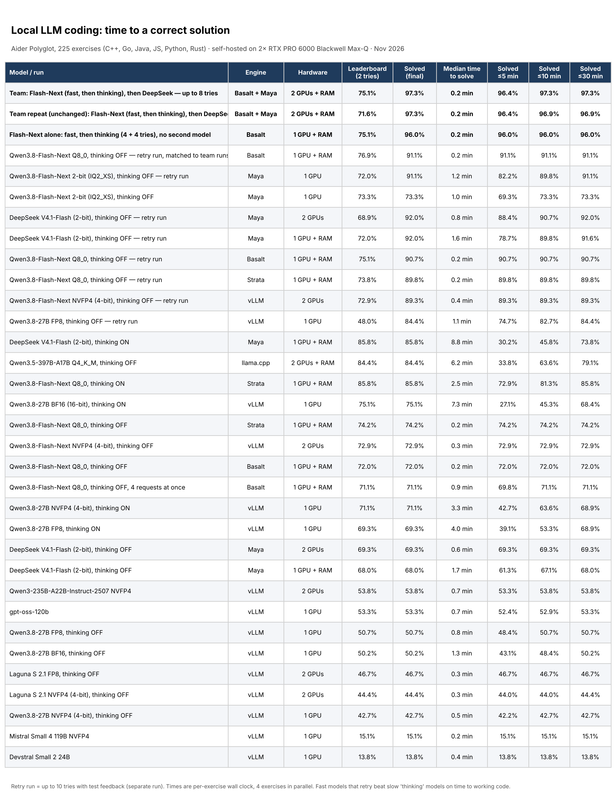

# Stop optimizing a model. Solve the problem.

*Preliminary results, 24 November 2026. One full run so far; a repeat is the next step. Brian K. Hudes, MD, AiMOS Systems.*

## Summary

Two open-weight models running on one desktop workstation, working as a team, solved **219 of 225 exercises (97.3%)** of the Aider Polyglot coding benchmark, with a median of **11.5 seconds** to a correct answer and no cloud calls.

The same fast coder working alone, with more tries, solved 90.7%. The second model working alone solved 92.0%.

The gain did not come from a bigger model or from more attempts. It came from changing *how* the work is done after a failure.

## The idea

Most local-inference work asks one question: how do I make this model faster or more accurate? Engines, quantization formats and leaderboards are all organised around a single model.

A person who needs working code asks a different question: how do I get a correct answer quickly? That question has more answers than "a better model". A fast model can try first. If it fails, the same model can slow down and reason. If that fails, a different model, with different blind spots, can look at it.

That is what we measured.

## Setup

- **Benchmark:** Aider Polyglot, 225 Exercism exercises in C++, Go, Java, JavaScript, Python and Rust. Diff edit format. Each attempt after the first sees the failing test output.
- **Hardware:** one Dell Precision T7920 with two NVIDIA RTX PRO 6000 Blackwell Max-Q cards (96 GB each) and 512 GB of DDR4 memory.
- **Models and engines:** Qwen3.8-Flash-Next (8-bit) on Basalt v0.5.5, and DeepSeek V4.1-Flash (2-bit) on Maya. Both were loaded at the same time, one per card.

The team works each exercise in this order and stops at the first correct answer:

| Tries | Model | Mode |
|---|---|---|
| 1-4 | Qwen3.8-Flash-Next | fast (thinking off) |
| 5-6 | Qwen3.8-Flash-Next | thinking on |
| 7-8 | DeepSeek V4.1-Flash | thinking on |

The order was chosen from earlier single-model runs on this machine: Flash-Next is the quickest route to a correct answer on most exercises, and thinking mode is slow, so it is only worth paying for on the exercises that need it.

## Results

| Measure | Team (up to 8 tries) | Flash-Next alone (up to 10 tries) | DeepSeek alone (up to 10 tries) |
|---|---|---|---|
| Solved | **219 / 225 (97.3%)** | 204 / 225 (90.7%) | 207 / 225 (92.0%) |
| Score after 2 tries | 75.1% | 75.1% | 68.9% |
| Median time to solve | 11.5 s | 13.6 s | 0.8 min |
| Total run time | 3 h 39 min | 2 h 40 min | - |

Who solved what:

| Stage | Exercises solved |
|---|---|
| Flash-Next, fast (tries 1-4) | 197 (85, 84, 21, 7) |
| Flash-Next, thinking (tries 5-6) | 20 (13, 7) |
| DeepSeek, thinking (tries 7-8) | 2 (1, 1) |
| Unsolved | 6 |

There were no infrastructure errors and no timeouts.

Three things stand out:

1. **Retrying the same way runs out quickly.** Fast-mode tries 3 and 4 added 28 exercises between them. The single-model run shows the same thing from the other side: ten fast tries stopped at 90.7%.
2. **Changing mode rescued most of the rest.** Turning thinking on for the 28 exercises still unsolved after four fast tries solved 20 of them.
3. **Speed was not given up.** Most exercises are still solved by the first fast tries, so the median stays at about 11 seconds. Only the hard exercises pay for thinking.

## How this compares with published results

The official [Aider leaderboard](https://aider.chat/docs/leaderboards/) allows two tries. Its top entry is GPT-5 with high reasoning at 88.0%, at about 194 seconds per exercise; the best open-weight entry is DeepSeek V3.2-Exp (Reasoner) at 74.2%. The page was last updated in November 2025, so newer models are missing.

**Our 97.3% is not a leaderboard score.** On the two-try rule the team scores 75.1%, level with the best open-weight entry and well below GPT-5.

The fairer comparison is with systems that are allowed to keep working until the tests pass. The highest such result we found is [Refact.ai's agent using Claude 3.7 Sonnet, at 93.3%](https://refact.ai/blog/2025/refact-ai-agent-achieves-93-3-on-aider-polyglot-benchmark/). We found none at or above 97%, though we did not search exhaustively. GPT-5 has no published work-until-correct result on this benchmark and would likely score above its 88% under these rules.

## Limits

- **One run.** In our repeat runs of single models, roughly a third of exercises flip between solved and unsolved. The direction of the result is clear; the size of the gain needs a second run.
- **Settings differ slightly between the team run and the single-model runs.** The team run had aider's chat-history summaries switched off; the single-model retry runs had them on. In a separate test, switching summaries off cut median time by about a quarter on its own. So the 11.5 s versus 13.6 s difference should not be credited to the team. A matched baseline is on the list.
- **The second model added only two solves.** This run shows that changing mode helps. It does not yet show how much a second model adds over thinking mode alone. A run without the second model will answer that.
- **This is a benchmark of small, self-contained exercises.** It is not evidence about large real-world codebases.
- **Tries are not equal in cost.** A thinking try takes far longer than a fast one, which is why the total run was an hour longer than the single-model run.

## What comes next

1. Repeat the team run to measure run-to-run variation.
2. A matched single-model baseline with identical settings.
3. The same cascade without the second model.
4. Other team compositions and other hardware configurations.

Results are posted to this repository as soon as each run finishes, so [RESULTS.md](../RESULTS.md) is always the most current record. It includes the runs that went badly. The engines are described in [ENGINES.md](../ENGINES.md). The harness that runs the team will be released once the result has been repeated.
